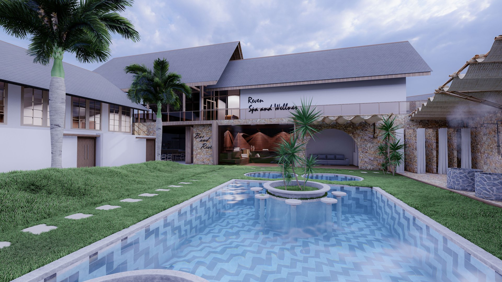

# Panduan Mengubah Isi & Gambar Portfolio

Bro, ini panduan lengkap untuk merubah konten (teks, harga, detail) dan gambar-gambar di website portfolio lu.
Bisa lu simpan panduan ini kalau suatu saat nemu gambar baru atau pengen nambah/merubah portofolio.

## 1. Mengganti Gambar

Semua gambar tersimpan di dalam folder `images/`.

### Cara Mengganti Gambar Card/Project:
1. Siapkan gambar baru lu (usahakan ukurannya seragam, misal 16:10 atau landscape biar rapi).
2. Pindahkan gambar baru lu ke folder `images/`.
3. Buka file `index.html` menggunakan Text Editor (VS Code, Notepad, dll).
4. Cari (Ctrl+F) tulisan `<div data-card="card-1">` (ubah angka 1 sesuai nomor project yang mau diganti gambarnya).
5. Di bawahnya, lu akan nemu baris kode seperti ini:
   ```html
   
   ```
6. Ganti `proyek_7x9_view1.jpg` dengan nama file gambar lu yang baru.
7. Simpan (Ctrl+S).

### Cara Mengganti Gambar Slider Paling Atas (Hero):
1. Cari (Ctrl+F) di dalam `index.html` bagian ini: `id="heroSliderContainer"`
2. Lu bakal nemuin beberapa elemen `img` seperti:
   ```html
   
   ```
3. Ganti nama filenya sama kayak gambar yang udah lu masukin ke folder `images/`.

## 2. Mengubah Data Project (Teks di Modal/Pop-up)

Kalau gambar di card diklik, akan muncul info lebih detail. Datanya ada di bagian paling bawah kode Javascript.

1. Buka file `index.html`.
2. Scroll sampai ke bagian paling bawah (sebelum `</script>`).
3. Cari `const projectsData = {`. Lu bakal nemu blok kode seperti ini:
   ```javascript
   'card-1': {
       img: 'images/proyek_7x9_view1.jpg',
       title: 'Modern Tropical Villa',
       category: 'Residential',
       dimensi: 'Luas Bangunan: 350 m2',
       desc: 'Desain villa tropis modern dengan perpaduan...',
       specs: ['• 4 Kamar Tidur', '• Kolam Renang Privat', '...'],
       waText: 'Halo Mas Adrian, saya tertarik dengan desain Modern Tropical Villa...'
   }
   ```
4. Lu tinggal ubah teks yang ada di dalam tanda kutip tunggal `'...'`.
5. Misal mau ganti judul, ubah `'Modern Tropical Villa'` jadi judul project lu yang baru.

## 3. Mengubah Harga Paket & Layanan

1. Cari tulisan harga paket di `index.html` (Ctrl+F dan ketik "Paket 01").
2. Nanti akan ketemu kode html harganya, contoh:
   ```html
   <div class="text-3xl font-bold text-white mb-2">Rp 10.000<span class="text-lg text-slate-400 font-normal">/m²</span></div>
   ```
3. Lu bisa langsung ubah angkanya di situ kalau besok-besok ada penyesuaian harga.
4. Jangan lupa kalau ubah harga, cek juga bagian Javascript kalkulator di baris ke-1560-an (`const priceMap = { base: 10000, pro: 25000, premium: 35000 };`) biar kalkulator otomatisnya harganya ikutan update.

---
**Tips**: Pastikan ukuran file gambar ngga terlalu besar (di bawah 1 MB) biar websitenya tetap cepat diakses (loadingnya ngacir). Lu bisa compress dulu gambarnya lewat web seperti *tinypng.com*.
